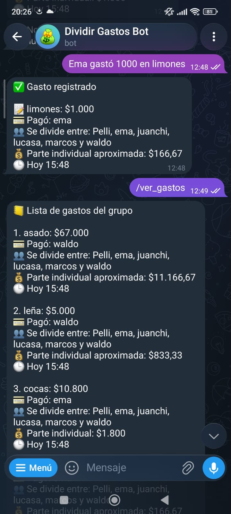
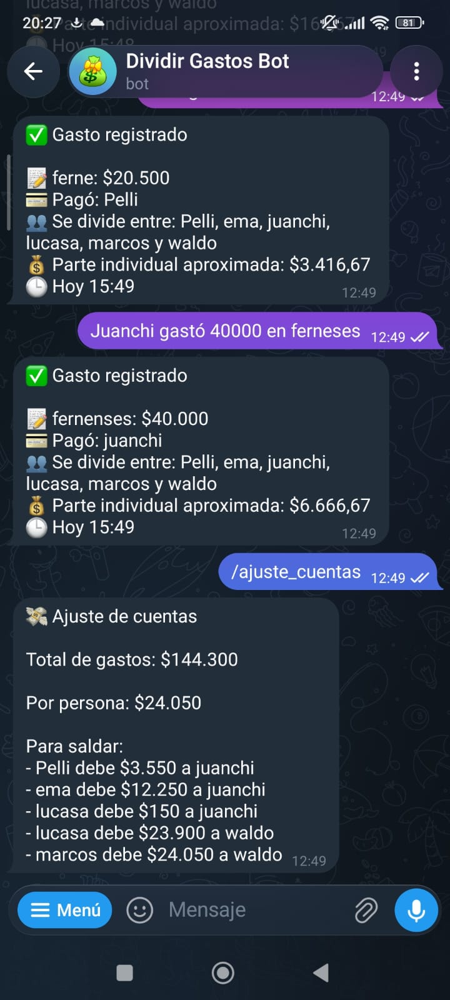

# Divide Expenses Bot

AI-assisted Telegram bot for tracking and splitting shared expenses.

Divide Expenses Bot combines natural-language input with traditional bot commands: expenses can be registered conversationally, while explicit commands provide predictable access to actions such as reviewing expenses and calculating the final settlement.

It started as a tool for splitting expenses with friends without having to maintain a spreadsheet or manually calculate who owes whom.

## Product

Create a group, record expenses in plain language, review what everyone spent, and calculate the transfers required to settle the group.

  
  &nbsp;&nbsp;
  
  &nbsp;&nbsp;
  

## Core capabilities

- Create groups of participants
- Register expenses using natural-language messages
- Detect payer, amount, description, and participants
- Register multiple expenses from a single message
- Review the group's expense history
- Calculate who should pay whom to settle the group
- Close a group and start a new one
- Use explicit Telegram commands for common operations

## Engineering highlights

### AI as an input layer

Natural-language messages are interpreted with OpenAI function calling and translated into structured application operations.

The model is responsible for understanding what the user means, while validation and financial calculations remain deterministic application logic.

This allows messages such as:

> Waldo gastó 67000 en asado

to become structured expense records without moving accounting rules into the prompt.

### Commands + natural language

Not every interaction needs AI.

The bot combines conversational input with explicit commands for operations where predictability and discoverability are useful, such as listing expenses or calculating the final settlement.

This keeps frequent data entry fast while preserving traditional bot controls for deterministic actions.

### Domain boundaries

Telegram is treated as an interface rather than as the application itself.

The code separates:

- AI interpretation
- group lifecycle
- expense management and settlement
- user management
- Telegram-specific commands and message formatting

Domain modules do not depend directly on Telegram, Express, or BullMQ.

### Ordered asynchronous processing

Incoming messages are processed asynchronously with BullMQ.

Processing is kept sequential where message order matters, preventing consecutive expense-related messages in the same conversation from being handled out of order.

## Tech stack

- TypeScript
- Express
- Telegram Bot API
- OpenAI
- BullMQ
- Redis
- SQLite
- Drizzle ORM
